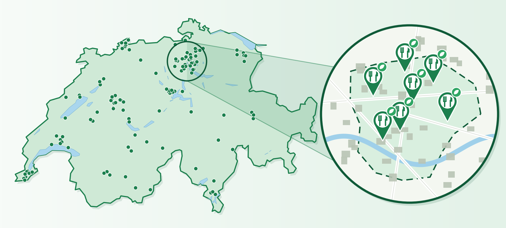
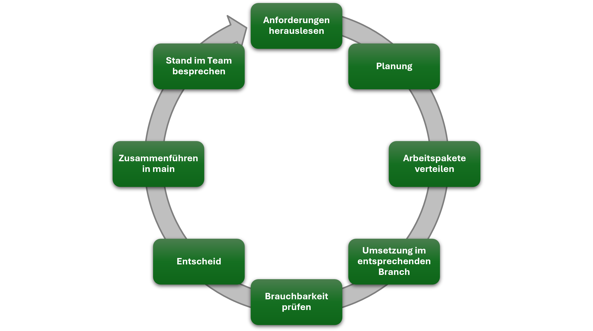

# Dichte veganer Restaurants in Schweizer Gemeinden



Projekt im Modul **Data Analytics** (Bachelor Wirtschaftsinformatik, ZHAW).

| | |
| :----- | :----- |
| **Gruppe** | 31 |
| **Studierende** | Jasna Simic, Marija Radovanovic, Jaden Fisch |

# Inhaltsverzeichnis
- [Einleitung](#einleitung)
    - [Hintergrund und Problemstellung](#hintergrund-und-problemstellung)
    - [Ziel und Forschungsfrage](#ziel-und-forschungsfrage)
- [Projektmanagement](#projektmanagement)
    - [Iteratives Vorgehensmodell](#iteratives-vorgehensmodell)
    - [VSC Struktur](#vsc-struktur)
- [Minimalanforderungen](#minimalanforderungen)
    - [Datenerhebung](#datenerhebung)
    - [Datenaufbereitung und Integration](#datenaufbereitung-und-integration)
    - [Datenspeicherung](#datenspeicherung)
    - [Explorative Datenanalyse](#explorative-datenanalyse)
    - [Modellierung und Evaluation](#modellierung-und-evaluation)
- [Zusatzanforderungen](#zusatzanforderungen)
    - [Kreativität der Umsetzung](#kreativität-der-umsetzung)
    - [PostgreSQL Datenbank](#postgresql-datenbank)
    - [Geografische Daten](#geografische-daten)
    - [Statistische Tests (Chi Quadrat, ANOVA, Korrelation)](#statistische-tests-chi-quadrat-anova-korrelation)
    - [k-Means Clustering](#k-means-clustering)
    - [GitHub Repository](#github-repository)
- [Resultate und Diskussion](#resultate-und-diskussion)
- [Schlussfolgerungen](#schlussfolgerungen)
- [Einsatz von KI](#einsatz-von-ki)
- [Anhang](#anhang)
    - [Quellenverzeichnis](#quellenverzeichnis)

# Einleitung

## Hintergrund und Problemstellung

Vegane Ernährung ist in den letzten Jahren in der Gastronomie sichtbarer geworden. Restaurants mit einem veganen Angebot sind in der Schweiz aber nicht gleichmässig verteilt. Vermutlich ist die Auswahl in grossen Städten und an Hochschulstandorten gross, während es in vielen kleinen und ländlichen Gemeinden kaum ein Angebot gibt.

Verzeichnisse und Karten zeigen zwar, wo es vegane Restaurants gibt, sie erklären aber nicht, **warum** das Angebot in manchen Gemeinden dichter ist als in anderen. Es ist unklar, welche Eigenschaften einer Gemeinde, zum Beispiel die Altersstruktur, das Einkommen oder der Anteil Studierender, mit einem dichten veganen Angebot zusammenhängen.

Dieses Wissen ist für verschiedene Gruppen nützlich:

- **Gastronomen und Gründer:** für die Standortwahl eines neuen Betriebs.
- **Gemeinden und Tourismusorganisationen:** um das eigene Angebot im Vergleich einzuordnen.
- **Konsumenten:** um zu sehen, in welchen Regionen die Auswahl gross oder klein ist.

## Ziel und Forschungsfrage

Wir möchten untersuchen, wo das vegane Angebot in der Schweiz am grössten ist und welche Merkmale einer Gemeinde dies erklären. Dazu berechnen wir für jede Gemeinde die **Dichte veganer Restaurants** (Anzahl pro 1000 Einwohner). Als Gemeinde gilt die politische Gemeinde gemäss BFS Gemeindeverzeichnis. Anschliessend untersuchen wir, welche Gemeindemerkmale mit dieser Dichte zusammenhängen, und vergleichen Gruppen von Gemeinden (z. B. städtische und ländliche Gemeinden).

> [!IMPORTANT]
> **Forschungsfrage:** Welche Merkmale einer Gemeinde (z. B. Altersstruktur, Einkommen, Anteil Studierende) erklären die Dichte veganer Restaurants (Anzahl pro 1000 Einwohner) in der Schweiz?

**Erwartete Ergebnisse**

Die folgenden Annahmen gelten vor der Analyse und betreffen die Merkmale, die wir als Erstes erwarten. Die genannten Merkmale sind Beispiele, weitere Gemeindemerkmale aus den BFS Daten (z. B. Gemeindetyp, Sprachregion oder Bevölkerungsgrösse) prüfen wir ebenfalls. Welche Merkmale wir am Ende verwenden, dokumentieren wir im Kapitel [Datenaufbereitung und Integration](#datenaufbereitung-und-integration). Ob sich die Annahmen bestätigen, zeigt sich im Kapitel [Resultate und Diskussion](#resultate-und-diskussion).

- Gemeinden mit mehr jungen Personen und Studierenden haben eine höhere Dichte, weil diese Gruppen vegane Angebote häufiger nachfragen.
- Gemeinden mit höherem Einkommen haben eine höhere Dichte, weil eine höhere Kaufkraft spezialisierte Angebote eher möglich macht.
- Städtische Gemeinden haben im Mittel eine höhere Dichte als ländliche, weil eine grössere Kundschaft Nischenangebote tragen kann.

# Projektmanagement

## Iteratives Vorgehensmodell

Wir arbeiten als Team zu dritt nach einem iterativen Vorgehensmodell, das die gesamte Zusammenarbeit abdeckt. Die Arbeitspakete werden pro Kategorie verteilt und jeweils im entsprechenden Branch umgesetzt. Nach der Besprechung im Team beginnt ein neuer Durchlauf.



| Schritt | Beschreibung |
| :----- | :----- |
| **1. Anforderungen herauslesen** | Projektauftrag und Bewertungskriterien lesen und festhalten, was als Nächstes verlangt ist. |
| **2. Planung** | Ziele, Reihenfolge und Zeitplan für den nächsten Durchlauf festlegen. |
| **3. Arbeitspakete verteilen** | Aufgaben nach Kategorie festlegen und auf die drei Personen aufteilen. |
| **4. Umsetzung im entsprechenden Branch** | Jede Person bearbeitet ihre Kategorie in einem eigenen Branch. |
| **5. Brauchbarkeit prüfen** | Das Ergebnis wird gegen die Anforderungen geprüft, der Code getestet und die Resultate kontrolliert. |
| **6. Entscheid** | Das Team entscheidet, ob der Branch gemerged oder überarbeitet wird. |
| **7. Zusammenführen in main** | Der geprüfte Branch wird in `main` gemerged. |
| **8. Stand im Team besprechen** | Kurze Besprechung zum aktuellen Stand und zu den nächsten Aufgaben. Danach beginnt der nächste Durchlauf. |

## VSC Struktur

### Branches

Das Modul ist auf Englisch, deshalb sind Branches, Commit Messages und Code auf Englisch. Jeder Branch beginnt mit der **Kategorie** (erstes Wort, Kleinbuchstaben). Danach folgt mit Bindestrichen eine kurze **Erweiterung**, die beschreibt, woran in diesem Branch gearbeitet wird: `category-topic`.

| Kategorie (erstes Wort) | Bereich | Beispiele |
| :----- | :----- | :----- |
| `readme` | README und Dokumentation | `readme-checklist`, `readme-conventions` |
| `presentation` | Präsentation und Video | `presentation-concept-slides` |
| `data` | Datenerhebung (API, Scraping) | `data-overpass`, `data-income` |
| `geodata` | Geodaten und räumliche Zuordnung | `geodata-spatial-join` |
| `database` | Datenbank (SQLite, PostgreSQL) | `database-sqlite`, `database-postgresql` |
| `eda` | Explorative Datenanalyse | `eda-distributions`, `eda-correlations` |
| `modeling` | Modellierung und Evaluation | `modeling-regression`, `modeling-poisson` |
| `analysis` | Zusatzanalysen (Bonus) | `analysis-kmeans`, `analysis-anova` |

**Regeln**

- Das erste Wort ist immer die Kategorie, die Erweiterung beschreibt den Inhalt (`category-topic`).
- Kleinbuchstaben, Wörter mit Bindestrich trennen, keine Umlaute, möglichst 1 bis 3 Wörter für die Erweiterung.
- Ein Branch gehört zu genau einer Kategorie und einem klar abgegrenzten Thema.
- Durch das iterative Vorgehen wird eine Kategorie mehrfach bearbeitet. Für jede neue Runde entsteht deshalb ein neuer Branch mit anderer Erweiterung (z. B. `eda-distributions`, später `eda-after-modeling`).
- Nach dem Merge wird der Branch gelöscht.

> [!TIP]
> Am Präfix sieht man in der Historie sofort, zu welchem Bereich eine Änderung gehört. Die Erweiterung zeigt, worum es genau ging. So bleiben Branches auch bei mehreren Iterationen eindeutig.

### Commits

Eine Commit Message hat das Format `type(scope): what was done` und ist auf Englisch.

- **type**: Art der Änderung (siehe Tabelle).
- **scope**: Kategorie aus der Branch Konvention (`readme`, `presentation`, `data`, `geodata`, `database`, `eda`, `modeling`, `analysis`). Sie entspricht dem ersten Wort des Branches.
- **Beschreibung**: kurz und konkret, im Past Tense, ohne Punkt am Ende.

| Type | Verwendung |
| :----- | :----- |
| `feat` | Neue Funktion, neuer Analyseschritt, neues Notebook |
| `data` | Daten hinzugefügt oder aktualisiert |
| `docs` | Dokumentation (README, Checkliste, Kommentare) |
| `fix` | Fehler behoben |
| `polish` | Verbessert, aufgeräumt, übersetzt oder umstrukturiert, ohne neue Funktion |

Beispiele:

```
feat(data): created Overpass query for vegan restaurants
data(geodata): added municipality boundaries and BFS directory
feat(geodata): assigned restaurants to municipalities with a spatial join
feat(database): created SQLite database with restaurants and municipalities
docs(readme): updated branch and commit conventions
fix(eda): corrected missing values in population
```

Bei mehreren zusammengehörenden Änderungen werden die Details nach einem Doppelpunkt aufgezählt:

```
feat(data): created Overpass query, saved raw data as JSON, added retry over two endpoints
```

# Minimalanforderungen

Dieses Kapitel hält die technische Grundlage unserer Untersuchung fest. Es folgt dem Weg der Daten, von der Erhebung über die Aufbereitung und Speicherung bis zur Analyse und zum Modell. In der Arbeit entspricht es dem Teil «Material und Methoden». Jeder Abschnitt erklärt, was wir gemacht haben und warum, damit die Ergebnisse nachvollziehbar bleiben. 

## Datenerhebung

> Beschreibung, wie die Daten selbst erhoben werden (Web Scraping und/oder Web API): welche Schnittstelle, welche Abfrage, welcher Umfang. Fertige Datensätze (z. B. von Kaggle) zählen nicht als primäre Quelle. Mit Referenz auf die relevanten Codestellen.

## Datenaufbereitung und Integration

Folgende zwei Datenquellen werden verwendet:

1. **OpenStreetMap** über die Overpass API (selbst erhobene Daten)
2. **BFS Gemeindedaten** (Bundesamt für Statistik)

## Datenspeicherung

> Beschreibung der SQLite Datenbank (Tabellen, Schema, Beziehungen) und der SQL Abfragen aus Python. Mit Referenz auf die relevanten Codestellen.

## Explorative Datenanalyse

> Beschreibung der nicht grafischen und grafischen EDA: Kennzahlen, Verteilungen, fehlende Werte, Zusammenhänge zwischen den Variablen und die wichtigsten Diagramme. Jede Grafik wird beschriftet und mit Quelle versehen.

## Modellierung und Evaluation

> Beschreibung der Zielvariable, der erklärenden Variablen und des gewählten Modells (Regression oder Klassifikation) samt Begründung. Evaluation mit geeigneten Gütemassen (z. B. R², RMSE, Accuracy, Precision, Recall) und korrekte Interpretation der Resultate. Erklärung, wie die Forschungsfrage über eine reine Vorhersage hinausgeht.

# Zusatzanforderungen

Mit den Zusatzanforderungen sind zusätzliche Punkte möglich. Pro Zusatzanforderung wird dokumentiert, wie sie umgesetzt wurde.

## Kreativität der Umsetzung

> Beschreibung dessen, was über die Inhalte der Lektionen und Übungen hinausgeht (z. B. eigene Datenquellen, besondere Analysen oder Visualisierungen).

## PostgreSQL Datenbank

> Beschreibung des Einsatzes einer PostgreSQL oder ähnlichen Datenbank (keine SQLite) mit SQL Joins und Aggregationen aus Python. Mit Referenz auf die relevanten Codestellen.

## Geografische Daten

> Beschreibung, welche geografischen Daten integriert und wie sie visualisiert wurden (z. B. Karte der Dichte pro Gemeinde).

## Statistische Tests (Chi Quadrat, ANOVA, Korrelation)

> Beschreibung des eingesetzten Tests (Chi² Test, ANOVA oder Korrelationsanalyse), der Fragestellung dahinter und des Resultats. Jeder Test muss einen p Wert enthalten.

## k-Means Clustering

> Beschreibung des Clusterings zusätzlich zum Regressions oder Klassifikationsmodell: verwendete Merkmale, Anzahl Cluster, Interpretation der Cluster.

## GitHub Repository

> Link zum öffentlichen GitHub Repository mit dem Code. Die URL muss auch in der Präsentation angegeben werden.

# Resultate und Diskussion

> Darstellung der Resultate der Datenintegration, der EDA und der Modelle samt Interpretation der Gütemasse. In der Diskussion werden die Resultate eingeordnet: Bezug zur Forschungsfrage und zu den erwarteten Ergebnissen sowie Grenzen der Analyse.

# Schlussfolgerungen

> Beantwortung der Forschungsfrage in wenigen Sätzen, Fazit des Projekts und mögliche nächste Schritte.

# Einsatz von KI

> Reflexion der KI Nutzung bei Code und Präsentation: welche Tools für welche Aufgaben eingesetzt wurden, welche Vor- und Nachteile gefunden wurden und wo es mit KI Hilfe nicht funktioniert hat.

# Anhang

## Quellenverzeichnis

| Quelle | Verwendung | Link |
| :----- | :----- | :----- |
| OpenStreetMap (Overpass API) | Vegane Restaurants | https://www.openstreetmap.org |
| Bundesamt für Statistik (BFS) | Gemeindedaten | https://www.bfs.admin.ch |
